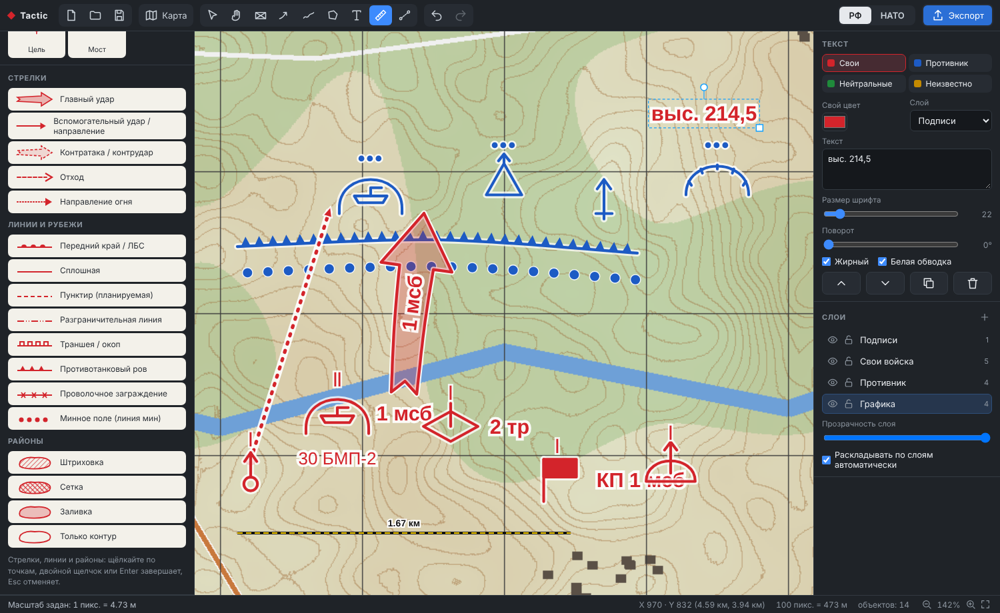

# Tactic — редактор тактических карт

Настольное приложение (Electron) для красивого черчения тактических карт: загружаете фото карты местности и наносите поверх условные знаки, стрелки, рубежи, районы и подписи.



## Возможности

- **Подложка** — любое изображение (PNG, JPG, WebP). Можно затемнить или обесцветить, чтобы знаки были заметнее. Файл можно просто перетащить в окно.
- **Условные знаки** — два набора с переключателем в шапке:
  - **РФ** — свои красным, противник синим; мотострелки, танки, БМП, БТР, ВДВ, разведка, артиллерия, САУ, миномёты, РСЗО, ПТУР, ПВО, инженерные, связь, РЭБ, тыл, КП, НП, авиация, БПЛА, огневые средства, объекты.
  - **НАТО APP-6** — через библиотеку [milsymbol](https://github.com/spatialillusions/milsymbol), свои синие, противник красные.
  - Для каждого знака: сторона, звено (отделение … армия), «планируемое» (пунктир), штаб, обозначение и примечание, размер, поворот.
- **Стрелки** по кривой: главный удар, вспомогательный, контратака, отход, направление огня.
- **Линии**: передний край / ЛБС, сплошная, пунктир, разграничительная, траншея, противотанковый ров, проволочное заграждение, минное поле.
- **Районы**: штриховка, сетка, заливка, контур; сглаживание, пунктир, подпись.
- **Текст** с белой обводкой, поворот, размер.
- **Слои**: видимость, блокировка, прозрачность, порядок; знаки сами раскладываются по слоям «Свои» / «Противник» / «Графика» / «Подписи».
- **Масштаб**: калибровка по двум точкам и линейка в метрах/километрах.
- Отмена/повтор, копирование, перетаскивание знаков из библиотеки, редактирование точек линий, автосохранение сессии.
- **Файлы**: проект `.tmap` (одним файлом, карта внутри). Экспорт в PNG (1× и 2×), SVG и PDF.

## Горячие клавиши

| Клавиша | Действие |
|---|---|
| V / H / U / A / L / R / T / M | выделение / рука / знак / стрелка / линия / район / текст / линейка |
| Пробел + мышь, средняя кнопка | перемещение карты |
| Колесо | масштаб |
| Enter / двойной щелчок | завершить стрелку, линию, район |
| Esc / Backspace | отменить рисование / убрать последнюю точку |
| Ctrl+Z / Ctrl+Y | отмена / повтор |
| Ctrl+C / Ctrl+V / Ctrl+D | копировать / вставить / дублировать |
| Delete | удалить |
| Стрелки (Shift) | сдвиг на 1 (10) пикселей |
| Ctrl+S, Ctrl+O, Ctrl+M, Ctrl+E, Ctrl+0 | сохранить, открыть, загрузить карту, экспорт PNG, показать всю карту |

## Запуск

```bash
npm install
npm run dev      # разработка: Vite + Electron
npm run build    # сборка интерфейса в dist/
npm start        # запуск собранного приложения
npm run dist     # установщик и portable-версия для Windows в release/
```

Нужен Node.js 20+.

## Устройство

- `electron/` — главный процесс (меню, диалоги файлов, экспорт PDF) и preload.
- `src/symbols/` — каталог знаков и генерация SVG для обоих стандартов.
- `src/graphics/geometry.ts` — сглаживание, контуры широких стрелок, украшения линий.
- `src/components/MapSvg.tsx` — отрисовка карты в SVG (используется и на экране, и при экспорте).
- `src/components/Canvas.tsx` — холст: инструменты, выделение, перетаскивание, масштаб.
- `src/store.ts` — состояние документа и история отмен.
